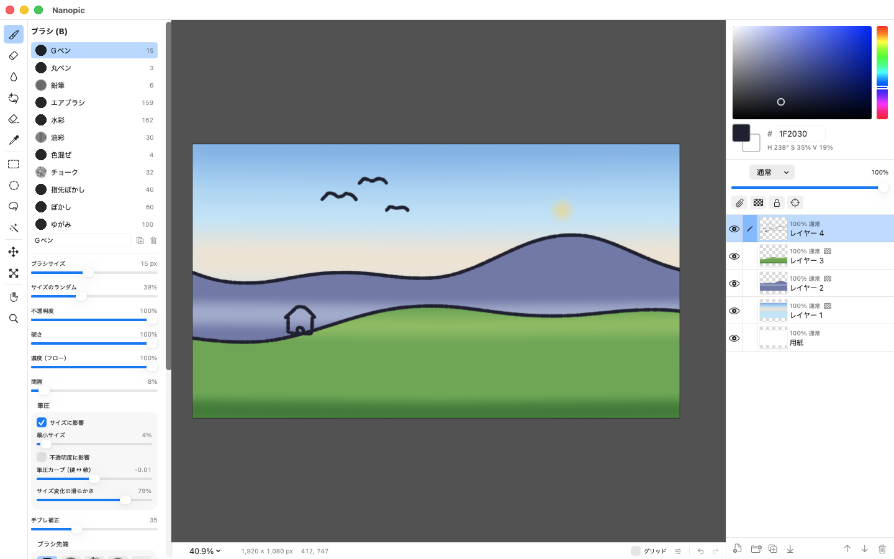

<h1>
  <picture>
    <source media="(prefers-color-scheme: dark)" srcset="website/assets/nanopic-white.svg">
    
  </picture>
  Nanopic
</h1>

Swift で書いた macOS 用のペイントツールです。

[サイト](https://hashrock.github.io/nanopic/) · [ダウンロード](https://github.com/hashrock/nanopic/releases/latest)



## ビルドと起動

```sh
./scripts/build-app.sh      # リリースビルドして build/Nanopic.app を生成
open build/Nanopic.app
./scripts/release.sh        # Developer ID で署名・公証して dist/Nanopic-<版>.zip を作る（配布用）
```

- 必要なもの: macOS 14 以降、Xcode 16 以降（Swift 5.10+）
- 表示言語: 日本語・英語（システムの言語に従います。[表示言語](#表示言語)）

### App Store 用のビルド

```sh
./scripts/build-appstore.sh   # エージェント連携（MCP）を外して build/appstore/Nanopic.app を生成
NANOPIC_APPSTORE=1 swift test --scratch-path .build-appstore   # App Store 用の構成でテスト
```

App Store 用のビルドには、エージェント連携（MCP サーバー、設定とメニューの項目、エージェント向けのツール）を入れません。実行時に隠すのではなく、コンパイルの段階で外します。

- `Package.swift` が環境変数 `NANOPIC_APPSTORE=1` を見て、アプリを `NanopicAgent` に依存させず、`Sources/Nanopic/Agent/`（MCP サーバー・設定画面・アプリ側のツール）をビルドから外し、`APPSTORE` を定義します。残りの呼び出し側は `#if !APPSTORE` で分けています
- ふだんのビルドと中間ファイルが混ざらないよう、ビルド先は `.build-appstore/` に分けます
- `build-appstore.sh` は、できたバイナリに MCP の文字列・シンボルと待ち受け（`NWListener`、Network.framework）が残っていないことを `strings`／`nm`／`otool` で確かめ、残っていれば失敗します
- `SANDBOX=1 ./scripts/build-appstore.sh` とすると、App Sandbox の entitlement（`scripts/appstore.entitlements`）を付けて ad-hoc 署名します。Sandbox の中での動作（サイドカーの読み書きなど）を手元で確かめるためのもので、配布用の署名ではありません
- 訳の表にも MCP の文言が入っていないことを確かめます（エージェント連携の画面の訳は `Resources/Agent.xcstrings` に分けてあり、App Store 用のアプリには表ごと入れません）
- App Store に出すのに要るもの（表示言語の申告 `CFBundleLocalizations` と `ja.lproj`・`en.lproj`、Info.plist の `LSApplicationCategoryType`・`ITSAppUsesNonExemptEncryption`、プライバシーマニフェスト `Resources/PrivacyInfo.xcprivacy`、1024px まで入ったアイコン、ユニバーサルバイナリ、通信や例外のない entitlement）も確かめます
- 直接配布（Developer ID、`release.sh`）のビルドは今までどおりエージェント連携を含みます
- iPad 版が使うライブラリ `NanopicKit` には、どちらの構成でも `NanopicAgent` を入れません

### Mac App Store

```sh
./scripts/package-appstore.sh --dry-run   # 証明書なしで流れだけ確かめる（ad-hoc 署名、署名なしの .pkg）
PROFILE=<.provisionprofile> ./scripts/package-appstore.sh   # 配布用に署名して dist/appstore/Nanopic-<版>.pkg を作る
```

`package-appstore.sh` は `build-appstore.sh` でアプリを作り、プロファイルを埋め込み、Apple Distribution で署名し、`productbuild` で `.pkg` にして Mac Installer Distribution で署名します。Apple とは通信しません（アップロードは Transporter か `xcrun altool` で別に行います）。

要るもの（どれも Apple Developer の Certificates, Identifiers & Profiles で作る）:

1. App ID `com.hashrock.nanopic`（Mac の直接配布版・Mac App Store 版・iPad 版で同じ ID）
2. 証明書 Apple Distribution と Mac Installer Distribution（キーチェーンでは `3rd Party Mac Developer Installer: ...` と出る）
3. Mac App Store Connect 用のプロビジョニングプロファイル（App ID は 1、証明書は 2 の Apple Distribution）→ `PROFILE` で渡す

- SwiftPM で作った `.app` をスクリプトで署名・`.pkg` 化しています（Xcode プロジェクトにはしていません）。直接配布版と同じ手順でアプリを組めて、違いが entitlement と署名だけになるためです
- entitlement（`scripts/appstore.entitlements`）は `app-sandbox`、`files.user-selected.read-write`（選んだ書類の読み書き）、`files.bookmarks.app-scope`（「書き出す」の書き出し先を覚える）の 3 つ。通信（`network.*`）はありません
- App Store 用はユニバーサル（arm64 + x86_64）です。直接配布版はビルドした Mac の向きだけです
- Bundle ID は 0.10.0 まで `dev.hashrock.nanopic` でした。直接配布版は、初回の起動で古い ID の設定（ブラシ・ショートカット・パレットなど）を引き継ぎます。ブラシ先端の画像（`~/Library/Application Support/Nanopic/tips`）は場所が変わらないのでそのまま使えます

### iPad 版

```sh
cd iPad && xcodegen          # project.yml から NanopicPad.xcodeproj を作り直す（brew install xcodegen）
open NanopicPad.xcodeproj    # スキーム NanopicPad を iPad／シミュレーターで実行
```

- `xcodegen` は、リポジトリのフォルダー名が `nanopic` のところで実行します（パッケージの参照にフォルダー名が入るため。worktree で作り直すと `project.pbxproj` に余計な差分が出ます）
- シミュレーターでは `xcrun simctl launch booted com.hashrock.nanopic -open <PSD のパス>` で書類を開けます（検証用。実機のビルドには入りません）
- iCloud container は `iCloud.com.hashrock.nanopic`（`iPad/Nanopic/Nanopic.entitlements`、Info.plist の `NSUbiquitousContainers`）。Apple Developer で container を登録し、App ID `com.hashrock.nanopic` に iCloud（CloudKit ではなく iCloud Documents）を付けると、実機のビルドとファイル App の「iCloud Drive › Nanopic」が使えます
- Archive（署名なしで通ることの確認）: `cd iPad && xcodebuild archive -project NanopicPad.xcodeproj -scheme NanopicPad -destination 'generic/platform=iOS' -archivePath ../.build-ipad/NanopicPad.xcarchive CODE_SIGNING_ALLOWED=NO`
- 表示言語は Mac 版と同じ日本語・英語。訳のカタログ（`Resources/Localizable.xcstrings`・`Names.xcstrings`）を Xcode がビルドのときに変換して入れます。Xcode は元の言語（日本語）の表を作らないので、`iPad/Nanopic/ja.lproj/InfoPlist.strings` を置いて、バンドルに `ja.lproj` と `en.lproj` の両方が入るようにしています（App Store の対応言語は `.lproj` から決まります）
- iPadOS 17 以降。描画エンジン（NanopicCore）と表示部品（NanopicUI）を Mac 版と共有しています
- Apple Pencil で描く（筆圧つき、ホバーでブラシの大きさを表示、ダブルタップでブラシ⇄消しゴム）
- 指 1 本で移動、2 本で移動・拡大・回転、2 本指タップで取り消し、3 本指タップでやり直し（ファイルメニューの「指で描く」で指 1 本でも描ける）
- ブラシ・消しゴム・塗りつぶし・スポイト、ブラシ設定、レイヤー（フォルダー・合成モード・不透明度・クリッピング・ロック）、色とパレット
- 投げなわ塗り・投げなわ消しゴム、選択範囲（投げなわ・矩形・楕円・自動選択）、移動・変形（反転つき）。Apple Pencil で操作する
- 描いている線の先は予測して仮の線で見せる（硬めのブラシのみ）
- PSD・画像を開く（ファイル App などからキャンバスへドロップしても開ける）、PSD で保存（ファイル App の「このiPad内 › Nanopic」）、PSD・PNG の書き出し。アプリを離れると、Nanopic フォルダーの書類は自動で保存します
- テスト: `swift test`（訳の抜けの検査 `scripts/check-localization.py` も走ります）
- 性能計測: `NANOPIC_PERF=1 swift test -c release -Xswiftc -enable-testing --filter PerfTests`

## 機能

| 分類 | 内容 |
|---|---|
| レイヤー | 複数選択（チェック列・⌘クリック・Shift クリック。まとめて移動／削除／フォルダーに入れる）、ラスターレイヤー、レイヤーフォルダー（入れ子可、通過／分離）、27 種の合成モード、不透明度、クリッピング、透明ピクセルをロック、レイヤーのロック、参照レイヤー、サムネイル、複製、下のレイヤーに結合、ドラッグ＆ドロップで並べ替え |
| 表示 | パン、ズーム（1〜6400%）、回転、グリッド（間隔・分割数・不透明度） |
| 選択範囲 | 矩形、楕円、投げなわ、自動選択。追加／削除／共通部分、反転、全選択 |
| トリミング | 選択範囲を囲む矩形にキャンバスを切り詰める（編集 ＞ 選択範囲でトリミング。全レイヤー） |
| 変形 | レイヤー移動、拡大・縮小・回転（ハンドル操作、Shift で縦横比固定・15° 単位）、左右／上下反転。選択範囲があれば選択部分のみ |
| 塗りつぶし | 参照先（編集レイヤー／他レイヤー／参照レイヤー）、色の誤差、領域拡縮、隙間閉じ、隣接ピクセルのみ |
| 投げなわ塗り | 囲んだ範囲を描画色で塗る／消す（投げなわ消しゴム）。選択範囲があればその中だけ |
| ブラシ | ブラシ先端画像（組み込み 6 種＋PNG などから読み込み）、硬さ、濃度（フロー）、間隔、角度、扁平率、進行方向に回転、角度のランダム、色混ぜ（絵の具量・色延び）、筆圧（サイズ・不透明度・カーブ）、手ブレ補正 |
| パレット | よく使う色を登録（＋で描画色を追加、クリックで描画色、Option＋クリックでサブカラー、右クリックで上書き・削除） |
| 色調補正 | 色相・彩度・明度（⌘U）、明るさ・コントラスト。値を動かすとその場でキャンバスに反映し、OK で確定（選択範囲があればその中だけ） |
| 立体的に振り向く | レイヤー ＞ 立体的に振り向かせる で、顔などのフォルダーを丸い立体に貼ったものとして左右・上下に振り向かせる（重なり順を奥行きに使い、後ろ髪は逆に動く）。見回すループを作り、リグパネルの「カーソルの方を向く」でマウスの方を向く |
| おまかせで動かす | レイヤー ＞ おまかせで動かす で、選んだレイヤー（フォルダー）に呼吸・ゆらゆら・ふわふわ・ぴょこぴょこ・なびく の動きを 1 回で付け、継ぎ目のないループで再生（リグを組まなくてよい） |
| アニメーションの書き出し | MP4・MOV（ProRes 4444）・APNG・GIF・PNG の連番（ファイル ＞ 動画を書き出し） |
| 履歴 | 取り消し／やり直し（最大 60 ステップ） |
| ファイル | PSD／PSB の読み込み、PSD 保存（フォルダー構造・合成モード・クリッピング・ロック・日本語名を保持）、PNG 書き出し、画像の読み込み |
| ショートカット | ツールごと・ブラシごとに単キー（Shift／Option との組み合わせ可）を割り当て（設定 ⌘, ／ツールやブラシの右クリック） |
| エージェント連携 | MCP サーバー（127.0.0.1 のみ、既定はオフ）。エージェントがレイヤー・ブラシ・塗りを操作し、線画の領域を探して下塗りできる |

## ファイルの形

絵は PSD で保存します。保存した PSD は、ほかのアプリでもそのまま開けます。スイッチフォルダー・タイムライン・リグ・書き出しの設定のように PSD に入らない情報があるときだけ、PSD の隣に同じ名前のサイドカー `作品.nanopic`（JSON）を書きます。

```
作品.psd       絵（レイヤー構成つき）
作品.nanopic   PSD に入らない情報。必要なときだけ作る
```

- PSD を移動・名前変更するときは、`作品.nanopic` も同じ名前で一緒に動かしてください。
- 以前の版が書いた `作品.nanopic.json` も読めます。次に保存すると `作品.nanopic` に書き、古いファイルはそのまま残します（両方あれば `作品.nanopic` を使います）。
- App Store 用のビルド（App Sandbox）では、`作品.nanopic` を「関連ファイル」として読み書きします。古い `作品.nanopic.json` は Sandbox の中から読めないので、直接配布版で一度開いて保存し直すか、`作品.nanopic` に名前を変えてください。
- iPad 版は、アプリのフォルダー（ファイル App の「このiPad内 › Nanopic」と「iCloud Drive › Nanopic」）の中でだけサイドカーを読み書きします。外の場所の PSD は素の PSD として開き（サイドカーの情報は読まず、保存しても書きません）、ツールバーに印を出します。印を押すと説明と「Nanopic のフォルダーに複製して開く」が出ます。サイドカーごと移すときは、ファイル App で PSD と `作品.nanopic` を一緒に Nanopic のフォルダーへ移します。

仕組みの詳細は [docs/animation.md](docs/animation.md) にあります。

## 描画品質の設計

- **高精度な入力**: `NSEvent.isMouseCoalescingEnabled = false` で、ペンタブレットのサンプルを間引かずにすべて受け取ります。座標は小数のまま扱います。
- **ストロークバッファ**: ストロークの途中は Float32 のバッファに描き、ペンを離したときにディザをかけて 8bit のレイヤーへ書き込みます。低濃度の重ね塗りでも段差（バンディング）が出にくく、不透明度が滑らかに変化します。
- **手ブレ補正**: One Euro Filter を使い、ペンを速く動かすほど補正を弱めます。これにより、遅い線では手ブレを抑え、速い線では遅れを減らします。ペンを離すと、補正で遅れた分もフィルタを回したまま滑らかに描き切ります。
- **補間**: Centripetal Catmull-Rom スプラインで点の間を補間し、弧長に沿って等間隔にダブ（ブラシの 1 スタンプ）を置きます。筆圧も同じスプライン上で連続的に補間します。
- **入り抜きの急変防止**: 実際に使う筆圧は、移動距離と時間あたりの変化量に上限を設けて前の値から追従させます（「サイズ変化の滑らかさ」で調整）。描き始めの筆圧がいきなり高くても、太さは 0 から徐々に立ち上がります。半径 0.5px 未満はサイズを小さくする代わりに濃度を下げるため、細い線の入り抜きも途切れません。

## 構成

```
Sources/NanopicCore/   描画エンジン（UI 非依存、テスト可能）
  Tile.swift           128px タイル、Copy-on-Write（Undo のスナップショット共有）
  Layer.swift          レイヤーツリー、合成モード
  Compositor.swift     タイル単位で並列に合成（フォルダー、通過、クリッピング）
  Brush.swift          ブラシ設定、ブラシ先端（ミップマップ）、Float ストロークバッファ
  StrokeEngine.swift   入力の平滑化、スプライン補間、筆圧の変化制限
  Editor.swift         ドキュメント・履歴・ツール操作
  Shortcuts.swift      ショートカットの割り当て
  Localized.swift      表示言語（L() で訳を引く、LName() で保存してある名前を訳して出す）
  Fill.swift / Selection.swift / Transform.swift / PSD.swift
Sources/NanopicAgent/  エージェント（MCP）向けのツール（コアとは別モジュールにして並列にビルドする）
  AgentTools.swift     ツールの処理（説明と引数の形は AgentToolSchemas.swift の JSON）
  Regions.swift / Gaps.swift  線画で囲まれた領域の分割と、線の隙間探し（下塗り用）
Sources/NanopicUI/     Mac 版と iPad 版で共有する表示部品（Metal の表示、色の選択、スライダー）
Sources/Nanopic/       macOS アプリ（SwiftUI パネル + AppKit/Metal キャンバス）
  Agent/               エージェント連携（MCP サーバー、設定画面、アプリ側のツール）。App Store 用ビルドでは外す
iPad/                  iPad アプリ（XcodeGen の project.yml、UIKit/Metal キャンバス + SwiftUI パネル）
Resources/             訳のカタログ（*.xcstrings）、アイコン、プライバシーマニフェスト
```

## 表示言語

日本語と英語で表示します。システムの言語に従います（アプリごとの言語は、システム設定の「言語と地域」で変えられます）。

元の言語は日本語で、日本語の文言がそのままキーです。英語の訳は `Resources/` のカタログにあります。

| カタログ | 中身 | 入るアプリ |
|---|---|---|
| `Localizable.xcstrings` | 画面の文言（メニュー、ボタン、パネル、ダイアログ、エラー、取り消しの名前） | Mac（直接配布・App Store）、iPad |
| `Names.xcstrings` | 保存する既定の名前（下の表） | Mac（直接配布・App Store）、iPad |
| `Agent.xcstrings` | エージェント連携の設定画面とメニュー | Mac の直接配布版だけ |

- **アプリへの入れ方**: SwiftPM（`swift build`）は `.xcstrings` を変換しないので、`scripts/build-app.sh` が `scripts/compile-localization.sh`（Xcode の `xcstringstool`）で `en.lproj/*.strings` にして `.app` の `Contents/Resources` に入れ、Info.plist の `CFBundleLocalizations` で ja・en を申告します。`ja.lproj` には空の表を置きます（キーがそのまま日本語の文言なので）。iPad 版は同じカタログを Xcode がビルドのときに変換します
- **訳の引き方**: SwiftPM のリソース（`Bundle.module`）は使わず、どのモジュールもアプリ本体（`Bundle.main`）を引きます。SwiftUI の `Text("保存")` のようなリテラルはそのままアプリ本体を引くので、共有部品（NanopicUI）も iPad 版も同じ表で済みます。`.app` の直下にリソースのバンドルを置かずに済み、署名もそのままです。SwiftUI を通らない側（`NSAlert`、エラー、enum の表示名、取り消しの名前、`String` を受け取る部品）は `L("…")`（`%.1f` のような書式つきは `LFormat`）で引きます（`Sources/NanopicCore/Localized.swift`）。エージェント連携の画面は `LA("…")` で `Agent` の表を引きます
- `swift run` とテストでは `.lproj` が無いので、日本語がそのまま出ます。英語の表示は `./scripts/build-app.sh` のあと `build/Nanopic.app/Contents/MacOS/Nanopic -AppleLanguages "(en)"` で確かめられます
- **エージェント（MCP）に返す文**（ツールの説明・結果・エラー）は訳しません。読むのがエージェントで、ツールの説明は表示言語で変わらないほうが扱いやすいためです

### 保存するデータには訳した文字列を入れない

書類（PSD）・サイドカー・設定に入る名前は、どの言語の画面で作っても同じ文字列（日本語）で保存し、画面に出すときに `LName()` で訳します。作ったときの言語で保存すると、英語で作った書類が日本語の画面でも英語のまま固まるためです。

| | 扱い | 例 |
|---|---|---|
| アプリが付ける既定の名前 | 日本語で保存し、出すときに `LName()` で訳す | `レイヤー 1`→Layer 1、`用紙`→Paper、`フォルダー 2`、`レイヤー 1 のコピー`、ブラシ（`Gペン`→G-Pen）、ブラシ先端、デフォーマ（`顔の呼吸`→顔 Breathe）、パラメータ（`パラメータ1`、`顔の左右の向き`） |
| ファイル名のもと | 作った時点の言語で決める | `無題`／Untitled |
| ユーザーが付けた名前 | そのまま（`Names` の表に無いので `LName()` を素通りする） | `線画`、`Layer 1`（自分で打ったもの） |

- 訳すのは `Names.xcstrings` にある名前と、その組み合わせ（`レイヤー %lld`、`%@ のコピー`、`%@の呼吸` など。`Localized.swift` の `NameLocalizer.patterns`）だけです
- 名前の入力欄には訳した名前を出し、打ち替えたときだけその文字列を保存します（訳した既定の名前のまま確定しても、保存してある名前は変わりません）
- 英語の画面で作った PSD をほかのアプリで開くと、既定のレイヤー名は日本語（`レイヤー 1`）で見えます
- 取り消しの名前（「取り消し: 描画」）は保存しないので、付けた時点の言語です

### 文言を足すとき

1. Swift 側に日本語で書く。`Text("…")`・`Button("…")` のリテラルはそのまま、`String` に入れてから渡すもの（三項演算子、`NSAlert`、`showError` など）は `L("…")` で包む
2. `Resources/Localizable.xcstrings` にキー（日本語の文言。`\(n)` の埋め込みは Int が `%lld`、String が `%@`、`%` は `%%`）と英語の訳を足す
3. `scripts/check-localization.py`（`swift test` からも走る）が、カタログに無い日本語の文言、訳の抜け、書式指定子の食い違い、App Store 用にも入る表への MCP の文言の混入を見つけます。訳さない行は `// l10n:skip`、日本語のまま保存する名前の行は `// l10n:stored` と書いて外します

英語の文言は Mac / iPad の標準の言い回しに合わせています（メニューとボタンは Title Case、`…` は 1 文字、Undo／Redo、Save As… など）。

## 主なショートカット

| キー | 操作 |
|---|---|
| B / E / G / I | ブラシ / 消しゴム / 塗りつぶし / スポイト |
| Shift+G / Shift+E | 投げなわ塗り / 投げなわ消しゴム |
| M, Shift+M / L / W | 矩形選択, 楕円選択 / 投げなわ / 自動選択 |
| V / ⌘T | レイヤー移動 / 拡大・縮小・回転（Return・選択解除・描画などで確定、Esc でキャンセル。確定前の Undo は 1 操作ずつ戻る） |
| Space（+⌘） ドラッグ | 手のひら（ズーム） |
| Option + クリック / 右クリック | スポイト（⌘ を加えると編集レイヤーから取得） |
| ⌘⌥ + 左右ドラッグ | ブラシサイズの変更 |
| [ / ] | ブラシサイズの縮小 / 拡大 |
| X | メインカラーとサブカラーの入れ替え |
| ⌘Z / ⇧⌘Z | 取り消し / やり直し |
| ⌘A / ⌘D / ⇧⌘I | 全選択 / 選択解除 / 選択範囲を反転 |
| Delete / ⌥Delete | 消去 / 描画色で塗りつぶし |
| ⇧⌘N / ⌘G / ⌘E / ⌘⌥G | 新規レイヤー / フォルダーに入れる / 下に結合 / クリッピング |
| ⌘0 / ⌘1 / ⌘; (⌘=, ⌘^) / ⌘- | 全体表示 / 100% / ズームイン / ズームアウト |
| ⌘' | グリッドの表示切替 |
| Shift+R | 表示の回転をリセット |

ツールのキーは設定（⌘,）の「ショートカット」で変えられます。ツールの右クリックやブラシ一覧の右クリックからも設定でき、特定のブラシ（例: 丸ペン）にキーを割り当てることもできます。

ツールのキーは、押したままキャンバスを操作するか長押し（0.4 秒以上）すると、キーを離したときに元のツールへ戻ります（例: ブラシ中に E を押したまま描くと消しゴム、離すとブラシ）。短く押したときはそのまま切り替わります。

PSD や画像ファイルをウィンドウにドロップすると開きます（Option を押しながらドロップすると、画像を新規レイヤーとして追加）。ペンの消しゴム側をタブレットに近づけると、自動で消しゴムツールに切り替わります。トラックパッドでは 2 本指でスクロール、ピンチでズーム、回転ジェスチャーで表示を回転できます。

## エージェント連携（MCP）

直接配布（Developer ID）版だけの機能です。App Store 用のビルドと iPad 版には入っていません。

設定（⌘,）の「エージェント連携」で MCP サーバーを有効にすると、Claude Code などのエージェントが開いているキャンバスを操作できます。この Mac の中（`127.0.0.1`）からだけ接続でき、既定ではオフです。

```sh
claude mcp add --transport http nanopic http://127.0.0.1:47823/mcp
```

操作は画面にそのまま反映され、⌘Z で取り消せます。主なツール:

| ツール | 内容 |
|---|---|
| `get_document` / `get_image` | レイヤー構成と見た目（座標の目盛りや一部の拡大も） |
| `find_regions` / `fill_regions` | 線画で囲まれた範囲を番号つきで返し、番号と色を指定してまとめて塗る（線の下まで塗り、隣にははみ出さない）。パーツごとのレイヤーにも分けられる |
| `find_gaps` / `close_gaps` | 線画の開いた所を探し、閉じ線レイヤーにまとめて閉じる（find_regions で線画と一緒に参照する） |
| `fill_leftovers` | 下塗りの細かい塗り残しを探し、接している色でまとめて埋める |
| `fill` / `lasso_fill` / `fill_selection` / `stroke` / `clear` | 塗りつぶし、多角形の塗り、選択範囲の塗り、ブラシの線（設定の一時的な上書き可）、消去 |
| `edit_palette` | パレットに色を足す・消す |
| `adjust_color` | 色相・彩度・明度、明るさ・コントラスト |
| `add_turn` | 立体的に振り向くリグ（左右・上下の向きのパラメータ）を付ける |
| `add_motion` | おまかせの動き（呼吸・ゆらゆら・ふわふわ・ぴょこぴょこ・なびく）を付け、タイムラインでループさせる |
| `select` / `transform` | 選択範囲（矩形・楕円・多角形・自動選択・レイヤーから・領域から）、移動・拡大縮小・回転・反転 |
| `add_layer` / `update_layer` / `move_layer` / `group_layers` ほか | レイヤーの作成・設定・並べ替え・フォルダーにまとめる・結合・削除 |
| `list_brushes` / `select_brush` / `update_brush` / `create_brush` / `set_color` | ブラシと色 |
| `batch` | 複数の操作を 1 回でまとめて実行 |
| `set_view` / `crop` / `resize_canvas` / `undo` / `redo` | 表示位置、キャンバスサイズ、取り消し |
| `open_file` / `save_psd` / `export_png` ほか | ファイルの読み書き（保存していない変更があると、明示しない限り閉じない） |

ブラシのサイズ・角度のランダムは、描き始めの点から決まる種で作るので、同じ入力からは必ず同じ絵になります。
